<h3><code>Aisyahnov@github ~ $ ./contributions.sh</code></h3>

  

<h3><code>Aisyahnov@github ~ $ whoami</code></h3>
<table align="center">
  <tr>
    <td valign="middle"></td>
    <td valign="middle"></td>
  </tr>
</table>

 

 
<h3><code>Aisyahnov@github ~ $ ./tech-arsenal.sh</code></h3>

  
<h3><code>Aisyahnov@github ~ $ ./links.sh</code></h3>

  

<!--
The animated profile-art pipeline is adapted from navi3582/animated-github-profile.
See LICENSE for the MIT license and attribution.
-->

